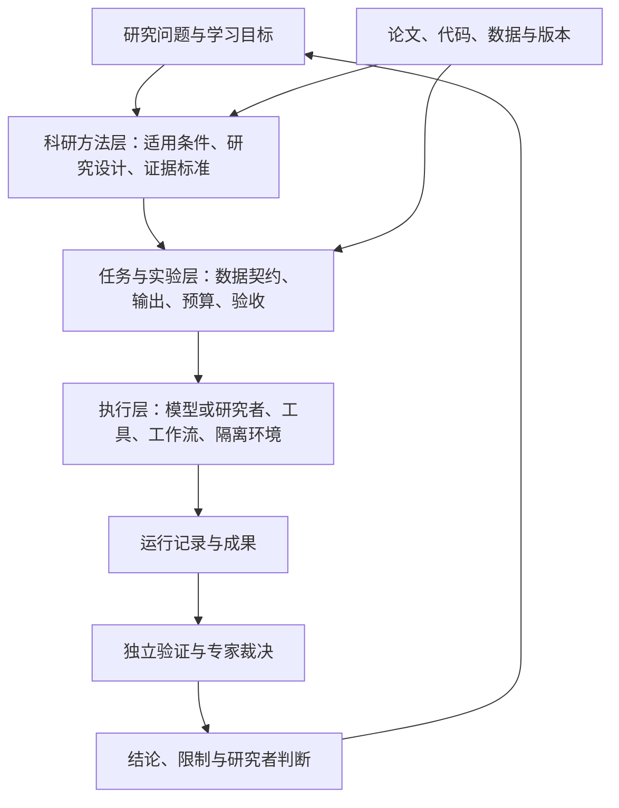

# 设计图景 v0.1

后续用户确认：本稿理解与实际预期基本一致，歧义登记中的处理方式已获确认；见 [确认记录](../ARCHIVE_POINTERS.md#archive-pointer-9d7e303c94b36b59)。原始接收稿和未决选型保留。

日期：2026-09-15。状态：**结构化接收稿，待具体任务试点验证**。

来源编号：[U1、A1、A2](../ARCHIVE_POINTERS.md#archive-pointer-efcac05c8b321014)。U1 是唯一返回的用户设计发言；A1/A2 是两条助手消息，接口没有交代二者的分支或修订关系。下面明确区分用户需求与本次建议，不把助手意见升级为已确认决策。

## 1. 目标与成果

**一句话定位（本次综合）**：面向生信干实验的研究与学习环境，将研究问题、方法适用条件、可重建计算和结论证据联系起来，并允许在独立协议下用于模型评测。

| 优先级 | 来源 | 目标 | 成功证据 |
|---|---|---|---|
| 首要 | U1 明确 | 帮助自身及初学研究者建立方法论体系 | 在撤去辅助的新任务中识别设计缺陷、说明方法选择和限制；具体教学试验尚待设计 |
| 支撑 | U1 的工程需求，A1/A2 细化 | 组织模型工程与数据分析专题，允许交叉 | 一个真实研究包可被另一位研究者理解、重跑、质疑与接手 |
| 可选后续 | U1 明确为“此外也可以” | 在可控条件下比较大模型专业表现 | 有冻结协议、独立评分、资源记录和适当的不确定性估计 |
| 推进前提 | U1 明确 | 先看已有方案是否足够，再决定自建 | 复用差距表和最小试点结果，而非仅列出产品功能 |

“纯学术目的”作为项目动机保留。资助、发布许可、商用限制、第三方资产权限是不同未决项，不替用户作许可决定。

## 2. 三层职责与两条专题

方法层定义应当回答的问题和必要条件；任务层把它变成可操作的研究作业；执行层提供真实计算。不能以执行成功替代方法或结论验收。

- **模型工程**：数据划分、表示、训练/微调、选择、基线、消融、外部验证、误差分析。
- **数据分析**：数据口径、质控、实验单位、混杂、统计建模、组学比较和解释。
- **共享维度**：领域专题 × 数据模态 × 研究阶段 × 复现类型。用组合标签表达交叉，不复制成两套基础设施。

## 3. 核心对象及最小字段（建议契约，尚非实现）

| 对象 | 至少包含 | 不可混淆的事实 |
|---|---|---|
| 资源登记 | ID、来源 URL/DOI、版本/提交、校验值、获取日期、许可状态 | 可读、可下载、可再分发不同；未知保持未知 |
| 研究问题 | 目标效应/预测对象、研究单位、目标泛化范围、假设与限制 | 探索性发现不同于预先定义的验证 |
| 数据契约 | 样本与标签含义、纳排、重复/配对、批次、划分、注释/坐标约定 | 细胞数量不同于独立供体数量；下游无重叠不证明预训练无污染 |
| 方法卡 | 适用条件、参数、替代方法、停止条件、验证、出处、偏离 | 原文报告、代码发现、项目补充和缺失项分开 |
| 任务定义 | 问题、可见资料、输入输出、预算、允许工具、评价接口 | 学习提示与盲测参考答案需要隔离 |
| 运行清单 | 各模型角色/版本、执行器、数据与环境摘要、种子、事件、失败、人工介入、资源 | 计划、实际执行和自述必须分开 |
| 结果与结论 | 产物 ID、指标/表格、对应运行、主张类型、替代解释、检查记录 | 显著关联不自动支持机制或因果结论 |
| 验收记录 | 检查器版本、输入产物摘要、结论、理由、审阅人/程序、日期 | 程序通过、科学有效性和研究者认可分别记录 |

建议使用稳定 ID 和相对引用连接对象；首版可用 Markdown + JSON/YAML + 文件清单。不以引入数据库或知识图谱为前提。RO-Crate 是待核验的互操作出口，而不是要求所有内部状态强行套入单一标准。

## 4. 模块与权限边界

| 模块 | 职责 | 首版倾向 |
|---|---|---|
| 资源与方法库 | 固定来源、条件、版本、缺口、反例 | 自建领域内容，复用格式与解析工具 |
| 任务与研究工作区 | 管理问题、计划、资料范围、输入与成果 | 薄适配层；输入与可写成果分离 |
| Agent/人工入口 | 提交计划、执行受许动作、解释与修订 | 支持人工基线；单执行者起步 |
| 执行与工作流 | 环境、作业、预算、恢复与轨迹 | 对 Inspect/Harbor 及 Snakemake/Nextflow 做选型，未选定 |
| 独立验证 | 干净重跑、结构/数值检查、科学判断 | 被测执行者不能改验证器与答案；专家有独立裁决入口 |
| 证据与学习反馈 | 结论来源、错误原因、提示程度、迁移反馈 | 值得重点验证的自建部分 |

答案隔离依靠真实权限和执行环境，不依靠“请不要读取”的提示词。参考解及评分器也可能有错，应能提交分歧与修订，而非单方面强制匹配某个软件输出。

## 5. 三种使用模式

| 模式 | 允许的行为 | 必须记录 | 评价目的 |
|---|---|---|---|
| 学习 | 提示、逐步解释、参考解按阶段开放 | 援助程度、尝试、反馈 | 理解与撤去辅助后的迁移 |
| 研究 | 探索、分支、方案更新、合理修正 | 何时及为何修订、探索/验证标签、失败 | 证据可审查、结论边界明确 |
| Benchmark | 按冻结协议执行；开放检索可另设赛道 | 全部运行、预算、工具、资料与裁决版本 | 指定条件下的系统表现 |

同一任务素材可有不同模式，但不能把学习过程中见过答案的记录当作盲测。固定 harness 比模型、允许原生能力比系统，是不同实验问题。

## 6. 证据状态不做单线自动升级

A1 提出的线性状态图有启发，但本次建议拆成独立维度，避免“验证通过即被接受”的歧义：

- 执行：未执行 / 已完成 / 失败 / 部分完成。
- 计算重建：未检查 / 通过 / 失败 / 条件性通过。
- 方法与结论：待审 / 支持 / 不支持 / 证据不足 / 有分歧。
- 研究者判断：未审阅 / 接受 / 保留 / 撤回。

每次变更保留依据及旧状态。散列证明文件身份，不证明科学正确；论文主张、本次观察、推断、未验证假设必须独立标识。

## 7. 最小闭环与阶段门槛

**阶段 0（本次）**：接收对话、固定设计理解、标注歧义、搜集一手文献与实现证据。

**阶段 1（下一步候选）**：先做一个完整研究包，再决定是否加第二专题。优先候选是有供体信息的小型单细胞差异分析，另一个互补候选是 RNA 表征/预测评估；尚未选定数据集。每包应有正常任务、信息不足或方法错误变体、人工参考分析、允许替代方法和独立验证。

验收：正常结果能重建；方法错误能被识别；合理替代解能通过；缺少必要资料时能准确解释不足；接手者能追到来源和运行。小样本冒烟检查不称为完整论文复现。

**阶段 2**：只在闭环有效后扩展约 8–12 个审计任务，覆盖不同错误机制。数量是 Chat 的试点建议，不是预算承诺或统计功效结论。

**阶段 3**：分别研究方法错误是否减少、学习迁移是否改善，再决定是否扩展 benchmark。已有组件若足够，交付高质量任务/方法包即可，不以自建平台数量衡量成功。

## 8. 接收立场

2026-10-12五案例驱动细化：[工程指导更新](11-case-driven-engineering-guidance.md)。保留本稿核心对象，通过条件化方法卡、交接记录一致性检查和无历史上下文评议落实指导；旧试点评分冻结，新版效果待复测。

2026-10-02新增组织设计：[理论层、应用层、执行层协作](07-agent-assistance.md)。应用层承担细分研究与执行报告的理解、综合，理论层负责方法判断及面向人的解释。此处是智能体职责划分，与系统模块和证据验收层次分别建模。

2026-09-29新增交付要求：每个完整研究包应包含[面向人类阅读的过程说明](06-readable-process.md)，以自然的语言和研究逻辑连接问题、理由、实际过程、结果及局限，并可追溯到结构化证据。它使用现有产物与验收契约，忠实性和可读性分别审阅；不以流畅叙述替代科学验收。

本次接受的是目标层次和需要验证的设计假设：方法论优先、证据可追溯、教学与评测分开、优先复用。未接受为既定事实的是任一候选工具的适配性、论文分数、任务开放规模、教学收益、自建优越性或学术新颖性。歧义及双方依据见 [专门登记](../ARCHIVE_POINTERS.md#archive-pointer-32e1713702a17085)。
