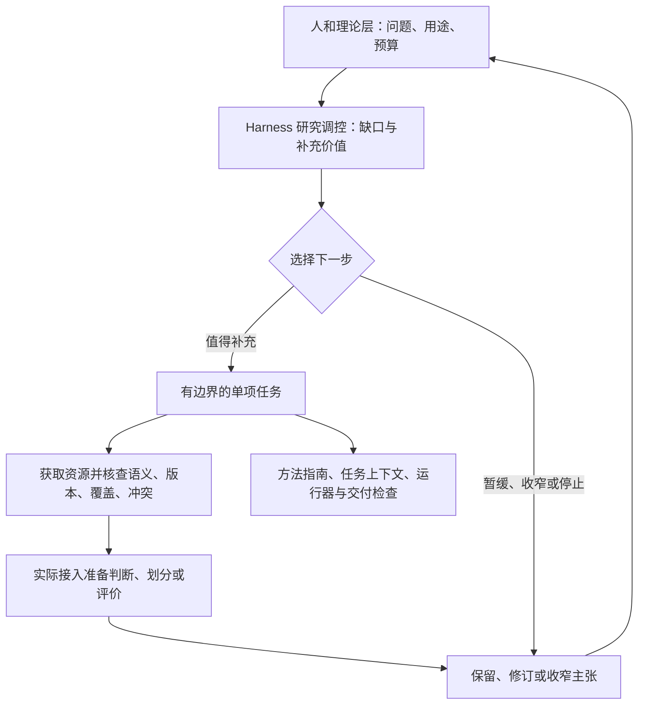

# D52：按证据缺口调控研究

## 架构归属

资源补全闭环放在 Harness 内部，作为按需启动的研究调控层。它围绕当前问题选择下一步，并调用已有方法指南、任务上下文和执行工具完成有边界的工作。资源获取器、数据库和模型平台通过接口接入；今后的研究工作台也可以调用同一层。

当前先围绕模型研究实现和检验这一层。若以后出现多个领域共有、且需要独立维护的调控能力，再把它提取为更大的框架。现阶段保持同一套研究对象、证据和决策记录，便于观察哪里真正需要进一步抽象。

## 六个相连的决定

| 环节 | 关键决定 | 必须接到的下一项信息 |
| --- | --- | --- |
| 发现缺口 | 缺的是输入、实体关系、测量定义，还是评价证据？ | 受影响的主张或用途 |
| 判断补充价值 | 什么资源可能改变判断，代价是否合适？ | 选择理由、预算、替代路线和停止条件 |
| 获取并核查 | 来源能提供什么，哪些关系已经核实？ | 来源版本、具体资源、覆盖和歧义 |
| 接入评价 | 这些信息实际用于哪个步骤？ | 消费程序、使用的记录和实际输出 |
| 更新判断 | 新证据支持保留、修改还是收窄？ | 结果与预定判据的对应 |
| 继续下一轮 | 还值得处理什么？ | 新方案或明确的暂停、停止决定 |

## 与单项任务的关系

调控层选择任务，单项任务执行已选路线。任务完成后将实际材料与结果交回调控层；一次文件下载或一次子进程结束，都只是其中一个动作。

沿用 [D51 的任务上下文](28-task-continuity-and-current-delivery.md)，让一次资源获取或准备评价属于明确的研究轮次。资源闭环再连接问题、资源要求、获取记录、资格判断、消费记录和主张决定。现有 Task、Artifact、Run、Decision 继续承担各自职责。

## 条件与替代

缺口会影响所选主张时才触发补充。固定档案窗口预测与未见基因泛化需要不同证据；基因映射不足时可以保留前者，暂缓后者。

每项资源按用途给出可用范围。基因、转录本、蛋白和家族分别命名；保留多对多关系和未知。覆盖门槛按问题提前选择，部分映射还要区分样本选择效应与分组方式的效应。

资源不足的判断也可以完成一轮准备任务：实际消费获取的资料，说明它仍未解决什么，以及因此怎样收窄目标。需要更强证据的评价留在后续方案中。

## 实施范围

本轮实现资源与消费证据的连接、条件出口及任务交付检查；获取动作由明确选择的数据库接口或下载程序承担。语义判断由应用层提出，理论层评议。Splice 的生物学分组准备已接通完整链：官方材料经实际读取后，实体关系与标签语义仍有缺口，因此收窄拟扩展主张。后续继续检验资源合格后进入新评价的分支。

使用方法见[资源缺口指南](../methods/guides/resource-gap-loop.md)，操作契约见[机器设计](../../machine/design/resource-gap-loop.json)。
