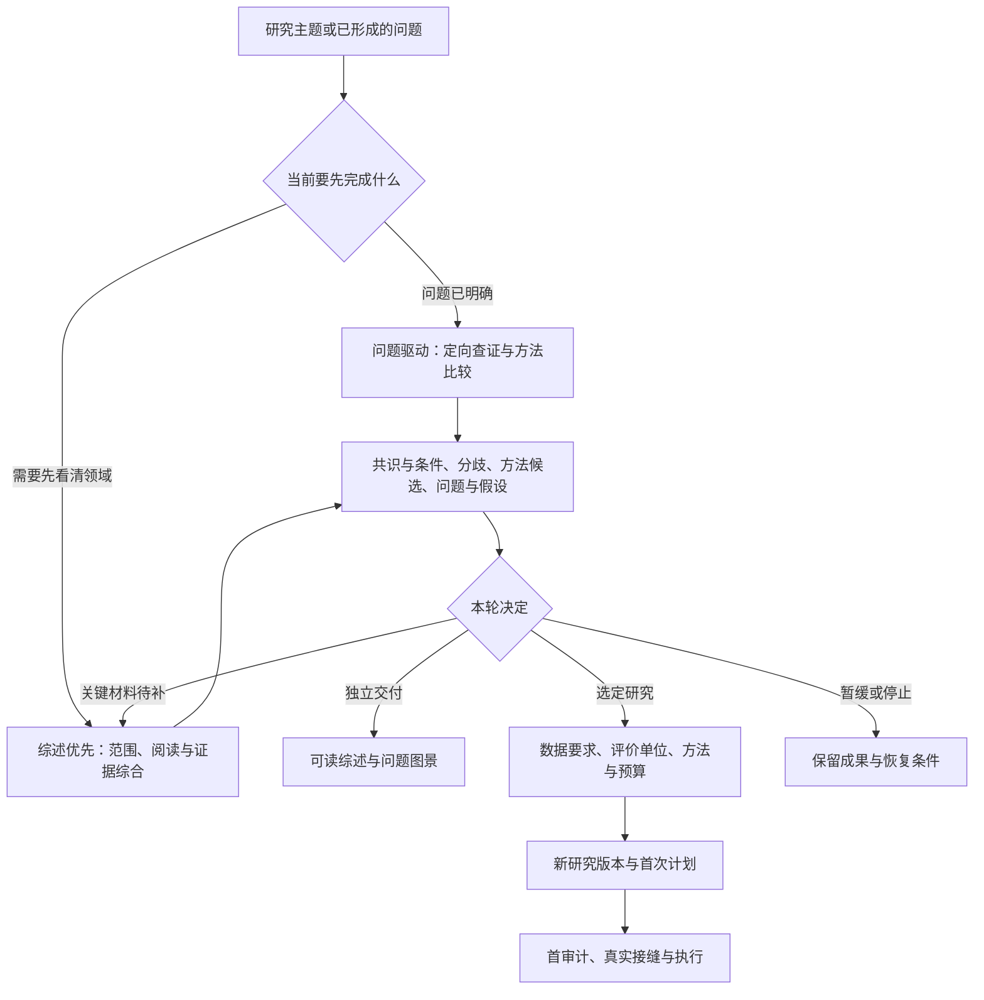

# D53：研究前期准备的两条路线

## 为什么增加这个入口

现有方法已分别说明来源阅读、资源资格、统计单位和首次执行。新研究还需要把这些环节连接起来：文献中的共识和分歧怎样形成候选问题，方法需要什么信息，何时值得进入实际研究。

本轮同时补齐公开资料获取工具的脚本、配置与测试，使方法指南中的获取命令可从独立核心目录使用。

## 决定

在 Harness 的方法层增加一个[统一准备入口](../methods/guides/research-preparation.md)，提供问题驱动与综述优先两条路线。两者共用来源与阅读账本、证据综合和方法候选记录；资料获取采用已有工具，具体研究继续采用已有资源闭环、任务上下文和首计划封存。

## 综述优先怎样完成

先解释对象、术语和研究目的，再比较实际读过的来源。每项主要判断连接其支持材料、适用条件和相反依据；相同工作的版本及共享数据分别归组。方法候选说明前提、代价、失败情形和替代，由此形成值得研究的问题。

[综述路线](../methods/guides/review-first-preparation.md)可以独立结束，也可以继续定向阅读。是否提出假设取决于问题；适用时把预测、竞争解释、区分证据与改判条件连接起来。就绪按本轮目标与实际覆盖判断。

只有明确选择后续研究时，才建立数据要求和具体首计划。综述阶段允许探索和修订重要范围，交付时保留覆盖快照；会改变样本纳入、清洗和划分的审计，按既有指南先封存方案。

## 取舍与后续检验

逐篇摘要容易留下材料而缺少问题之间的关系；过早要求数据和运行方案又会压缩探索。本设计让证据综合成为独立的研究产物，并把转入执行作为有理由的选择。

先用可复制的[模板和已有材料填写例](../../examples/research-support/preparation/README.md)检查衔接，再选真实研究检验综述的深度与选题作用。精确字段和适用条件见[机器契约](../../machine/design/research-preparation.json)。
