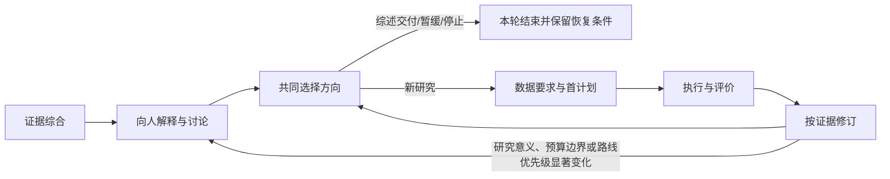

# D54：研究指导闭环

## 问题

D53 把来源阅读、证据综合和研究准备连接起来；D51 绑定当前任务与交付；D52 按资源缺口选择下一步。研究者仍需要把综合结果讲给人听，结合人的真实用途与约束共同选方向，再把决定接回数据要求、执行结果和后续判断。

不同任务的路径并不相同。综述可以作为独立成果交付；已授权的小任务可以继续；真正需要人决定方向、关键测量、预算边界或用途变化时，应把待决问题呈现给人。每一步都要求同样的审批会拖慢常规工作，跳过关键讨论又会让研究目标和执行脱节。

## 决定

在现有 methods 层提供条件性研究指导闭环：

周期记录按证据综合、人与研究者讨论、方向选择、数据与首计划、执行与评价、证据修订六个阶段推进。机器状态表达阶段接缝齐备、等待实际意见或需要补充前置条件；报告结果记录结构检查通过或失败。科学结论由对应研究评价另行判断。

面向人的综合应解释对象、测量和用途，说明方法演变的动机关系，呈现有条件的共识、开放分歧和少量竞争解释，并给出可行选择、推荐、资源代价和改判条件。若只有一条可行路线，说明限制条件。最后收束到人需要决定的一两个问题。实际人的选择、理由和约束通过讨论记录回连到发现、候选问题与方法。

## 条件与取舍

- 综述可独立交付；继续阅读、转入新研究、保持现状、暂缓和停止都是有效出口。
- 不要求每个小操作都经过讨论。已授权且不改变目标、优先级、关键测量、用途或预算边界的常规工作沿已有任务上下文继续。
- 明确需要人作选择时，所选路径由本轮真实讨论支持；已有授权适用于目标、用途和约束均在原范围内且无需新选择的延续工作。
- 讨论简报准备好后可进入对话；方向选择需要实际讨论来源和有效选项，并由人的回复支持。
- 方向选择及后续阶段将所选问题和方法映射到 D53 证据图中的身份。Harness 原生路径使用 D53 study bridge，并与 D51 任务身份、首计划版本和标准封存 ACK 一致。已有平台若提供等效任务、决策与执行证据，可通过适配或人工复核接入。历史窗口进入当前问题时默认提供可读的更新记录；更新可以是实际补查，也可以是有理由的适用性评议，不规定新增文献量。若研究对象是相同历史窗口，记录原截止时间、as_of和沿用理由，无需补充窗口外证据。
- Harness 原生执行评价使用实际的、非计划态有界运行证据，包含 PID、工作目录和当前任务绑定，并连到评价、证据与交付引用。其他合法平台通过对应适配或人工复核接入。检查器核对原生记录关联，研究评价另行判断结果对主张的支持。
- 见到结果后改变计划时另存新版本；原首计划与保护评价集保持原样，调整理由及受影响条件可追溯。

研究周期、D53 来源账本、D53 证据图、讨论记录和首计划分别维护自己的版本与路径，记录间只要求明确引用，不要求版本号同步。阶段变化而研究范围和 D51 任务绑定不变时，讨论记录与首计划沿用原版本和路径；同一份真实运行也可从执行评价继续供证据修订引用，无需因阶段变化重跑。研究范围、目标或 `iteration_id` 变化时，按 D51 核查新的任务绑定；旧运行保留为历史证据，不能作为身份不匹配的新任务运行。

## 与现有接口的关系

D54 复用[D53研究准备](../methods/guides/research-preparation.md)的来源账本、证据图与 study bridge；复用[D51任务连续性](28-task-continuity-and-current-delivery.md)维持身份、恢复入口和本轮交付；遇到资源缺口按[D52资源闭环](29-evidence-gap-control.md)处理。首个会改变纳入、清洗或划分的审计沿用[计划封存](../methods/guides/plan-seal-and-first-execution.md)，真实程序交接沿用[工件生产—消费接口](../methods/guides/artifact-producer-consumer.md)。

本设计提供一个供研究者、应用层和执行工具共同使用的阶段接口，不建立新的研究对象或通用审批流程。执行实现、示例记录和本设计的完整字段分别见[周期示例](../../examples/research-support/research-cycle/README.md)与[机器契约](../../machine/design/research-guidance-cycle.json)。本文件记录设计理由；科学结论由对应研究评价另行判断。
