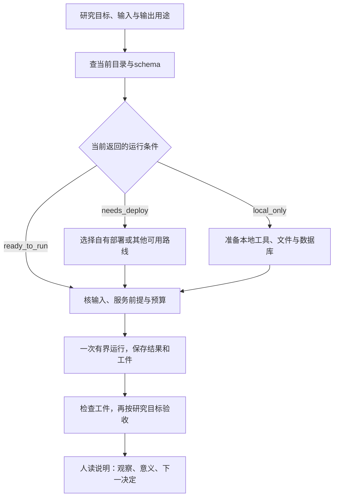

# Proto工具调用：从研究问题到可消费工件

版本 `proto-tool-use-v1`，2026-10-19。本指南按需要选用，不新增所有研究都必须执行的步骤。适用于从Proto查询数据库、运行序列/结构分析或接入已有生物模型；依据为[公开研究设计与方法索引](../../../../docs/REFERENCES-AND-DESIGN.md)。

## 先判断它在研究中承担什么

Proto把不同工具的输入、配置、输出和环境接到共同接口，适合减轻装依赖、找调用方法和转交结果的工作。其[官方框架](https://proto.evodesign.org/about)还提供序列、生成器、约束和优化器的组合设计；本轮只检查工具接入，没有执行组合设计程序。

Harness继续负责研究目标、方法选择理由、信息用途、验证与改判。选到一个工具之后，仍须说明它的输出怎样影响当前决定。例如，结构叠合回答两个给定结构的几何对应；界面置信评分用于评价给定预测复合物；二者与实验结合功能的证据要求不同。

| 当前需要 | 优先考虑 | 准备的材料与交付 |
| --- | --- | --- |
| 获取已有结构的条目信息、序列和注释 | `pdb-fetch-entry`、`uniprot-fetch`、Ensembl/NCBI系列；坐标需另取原件，预测结构可另查`alphafold-db-fetch` | 明确accession、来源版本和对象；PDB条目元数据不含坐标，实际PDB/mmCIF另行获取并保存身份 |
| 解释已有结构的形态、二级结构或界面质量 | `structure-metrics`、`pdockq2`；需要时选DSSP或ipSAE | 实际PDB/mmCIF、model/assembly、链和残基映射；保留缺失/过滤范围及评分前提 |
| 比较两个已有结构并作可视解释 | `tmalign-alignment`、`usalign-alignment`或`pymol-rmsd-alignment` | 先决定比较单位、对应链和原子集合，再保存变换、对应与可选叠合PDB；图像另行生成并验收 |
| 核酸序列的ORF、比对、二级结构或变异注释 | `orfipy-prediction`、`mafft-align`、`viennarna-prediction`、`ensembl-vep` | 说明DNA/RNA字母、方向、完整上下文、参考组装/转录本与坐标；输入和输出按ID衔接 |
| 使用蛋白/基因组模型、结构预测或设计流水线 | ESM/Evo、Boltz/AF/Chai、ProteinMPNN等目录项 | 先核后端、权重及许可、任务输入和预算；若用途涉及科学结论，再采用相应领域验证 |

当前目录未见专门的mRNABERT、UTR-LM或TE预测接口；本项目的TE流程沿用其自身数据和权重。RNA二级结构可以作为另一个诊断，不替代TE测量或预测任务。

## 目录存在、可调度和跑过分别记录

本轮成功调用 `workspace_info()`、完整与当前可运行的 `list_tools()`。返回160项操作、17类：33项 `ready_to_run`、114项 `needs_deploy`、13项 `local_only`。这是2026-10-19当前连接的快照，详见[公开研究设计与方法索引](../../../../docs/REFERENCES-AND-DESIGN.md)。

- `ready_to_run`：当前服务认为有可用路线；继续核输入、第三方服务凭据/限额和schema的前提。仅凭此标志不能记为实际运行成功或免费。
- `needs_deploy`：当前远程路线需要先满足部署条件。CPU也可能有这一状态；本轮有29项非GPU工具需要部署。
- `local_only`：依赖本机数据库、文件、安装或适合本地执行的长流程。按返回的具体原因准备本地环境，不把本机路径字符串交给远程服务器当成文件已上传。

本轮Modal与Hugging Face均未连接、自有部署数为0，仍返回33项ready。`mmseqs2-homology-search`带GPU标志而处于ready；可调度某个后端与自己拥有GPU/部署是不同观察。公开网页的托管试用说明也不能直接推断当前MCP所有目录项已开放。

这里是选路图，不表示部署或本地准备已完成。

## 调用顺序

### 1. 确认连接与选择工具

首次使用或配置异常时查询 `workspace_info()`。将Proto连接、Modal、Hugging Face和独立服务的凭据前提分别检查；报告只保留必要的连接标志，不存邮箱、用户/工作区ID或凭据值。

按问题使用 `search_tools(query, deployed_only=...)`；需要扩展候选时再看完整 `list_tools(deployed_only=false)`。`list_tools()`默认只列当前服务支持运行的项，不是全部工具，也不是自有部署清单。实际工具名及参数以当前暴露的定义为准。

### 2. 读取契约和来源

按当前Proto工具契约，构造输入前先调用：

1. `get_tool_schema(tool_key)`：读取实际input/config/output和当前返回的status等运行信息。未暴露的字段不自行补成肯定或否定。
2. `get_tool_example(tool_key)`：取已声明的标准例子；返回空值也如实记录。需要接口起步检查时可使用 `use_example=true`；它不是当前研究的真实输入。
3. `get_tool_info(tool_key)`：保存原方法的论文/仓库/权重链接、Proto包装器来源及许可信息。方法引用与包装器实现分别署名。

标准例子主要用于理解嵌套输入形状。自己的输入须按实际schema构造，不能只将本机文件名代入远程路径字段；结构字符串、序列对象、文件引用或服务器可读来源按schema选择。

若当前服务没有暴露部署revision、实际消费的权重版本或数据库快照，明确记为unknown；论文链接、checkpoint链接和Proto旧源码pin各有用途，不能充当本次运行实际消费的版本证据。

### 3. 确定预算与首个工件

为当前任务写明对象数/长度、链/原子选择、数据库和参数、输出位置、时间/计算预算及失败出口。先选能回答当前问题的最小工件；单结构或小序列面板是可选起步方法，不成为所有任务的固定规模。

按[公开研究设计与方法索引](../../../../docs/REFERENCES-AND-DESIGN.md)区分ChatGPT访问、Proto托管、Modal计算/存储和第三方服务。当前无付费部署或模型运行验收。Proto的 `deploy_tool` 明示会在用户Modal账户构建并产生费用，需要在该实际部署步骤获得确认；目录/schema/example/info查询不需要这项部署确认。

截至本次公开调查，没有取得Proto独立月费或托管试用的金额/周期。Modal Starter公示无月费、每月含30美元compute额度，使用其workspace预算控制消费；environment级预算是更高计划的功能。该额度不覆盖所有Modal产品，标准Functions的单价也不能直接套给Sandboxes/Notebooks。HF账号、权重许可和HF PRO分别判断，不把PRO当作所有模型的下载前提。

若选择自有Modal，先确认账号连接和当前目标工具的预算，再按该工具的部署确认调用 `deploy_tool(tool_key)`。部署完成后重新检查目录/schema，再提交计算；只部署本次需要的项。选择本地路线时，按实际工具准备依赖、文件、数据库和权重，首次环境建立的时间与存储也计入任务资源。

### 4. 一次提交，按标识回收

使用 `run_tool(tool_key, inputs, config, ...)` 或声明的标准例子运行。保存实际输入、配置、响应与后端信息。调用包含的科学输入须属于当前研究任务允许交给该服务处理的材料。

- 结果若是 `pending`，保存 **tool_key和job_id**，再用 `get_run_status` 查询同一次运行。连接超时后先查远端状态，避免重复提交。
- 部署若异步或超时，用 `get_deploy_status(tool_key)` 查已发起的部署。`tracked=false` 只说明追踪记录未保留，是否已部署另查当前目录。
- 轮询按任务给定间隔、上限和停止条件进行，保留失败和未知出口。轮询到期后先登记当前状态，不重复部署或计算来“确认结果”。

### 5. 把结果变成可消费工件

完整输出和下载资产按实际响应保存。下载链接不可达时可用 `get_asset(asset_id, ...)`；当前工具最大内联上限1MiB，仍不适合将大文件塞进聊天。链接过期时先查同一job的状态以取得新链接，不重跑科学计算。

保存实际文件的字节身份，并检查格式、ID、行数、链/残基或坐标、输出单位及必要字段。可按任务组织为 `request.json`、`result.json`、`assets/`、`citations.json` 和 `handoff.md`；这是组织建议，不要求所有任务生成空文件。生产—消费接口另见[对应指南](artifact-producer-consumer.md)。

Proto[当前隐私政策](https://proto.evodesign.org/privacy)将外部插件中未永久保存的内容保留七天；状态/资产查询可能续期。应主动下载需要保留的结果，以本地研究包承担长期追溯。

## 三条可用的工作路线

### A. 公开结构 → 小型几何诊断 → 人读图

适用：已有明确结构来源，想解释某个区域或处理步骤。

先取 `pdb-fetch-entry` 的准确schema，查询条目标题、方法和分辨率；它只返回条目元数据，**不提供坐标文件**。然后从RCSB条目的来源链接另取真实PDB/mmCIF原件，记录下载身份，并检查实际model/assembly和格式。若改用`alphafold-db-fetch`获取预测结构，需相应改变来源和解释。取得并保存真正的结构内容后，才按 `structure-metrics` 的输入对象构造调用；元数据JSON不能直接当结构传入。

检查链数、缺失、指标单位与异常值。需要展示时采用本项目[公开研究设计与方法索引](../../../../docs/REFERENCES-AND-DESIGN.md)。已有PyMOL安装的历史验证继续作为那一版本的记录，实际执行时重新检查当前环境即可。

图注回答：这是实验结构还是预测模型、看哪个区域、做了什么处理、哪些部分省略。三维旋转是观察视角，不写成分子动态；单个几何摘要也不直接解释功能。

### B. 两个结构 → 对应/叠合 → 比较解释

适用：比较同一生物单位、构象或预测与参考。先写清比较对象和链映射，再选TM-align、US-align或PyMOL方法；具体规范化、方法参数、selection和叠合输出见[公开研究设计与方法索引](../../../../docs/REFERENCES-AND-DESIGN.md)。本轮三类对齐目录项需要部署，现有本地PyMOL是可考虑的独立路线，不能把远程候选写成已运行。

保存两份输入、对齐覆盖、对应/变换、两种归一化分数（工具返回时）及可选叠合PDB。出图前检查实际保留的原子和残基，图中文字与被比较区域一致。若研究问题是复合物结合质量，则另判断pdockq2/ipSAE所需置信信息和适用体系，不能将任意PDB的B-factor默认为pLDDT。

### C. DNA/RNA序列 → 坐标明确的注释或结构 → 验证方案

适用：ORF、序列比对、RNA二级结构或具体变异注释。

- ORF检测要说明使用完整转录本还是片段、链方向、遗传密码表及起止和partial规则。变量区出现AUG是序列特征；判断uORF需结合这些边界与翻译证据。
- 比对时保存序列ID和原序列到带gap序列的位置映射；核酸与蛋白不能只按字符串相似而混用参数。
- ViennaRNA分析保存温度、能量模型等当前schema所支持的参数，以及dot-bracket和对应序列；绘图工具负责呈现，结构预测与真实构象的证据类别仍保留。
- VEP等变异注释应绑定物种、参考组装、参考/替代等位及转录本选择，先检查参考匹配再解释后果。

当前ORF、MAFFT、ViennaRNA均属需部署候选，具体前提以schema为准。选本地工具或人工已验证注释是合法替代；其依据、版本和接受条件单独记录。

## 交给人时交什么

交接首先用自然语言回答四件事：**想回答什么、实际做了什么、观察怎样改变判断、下一步做什么**。再链接精确输入/配置、原始响应、资产、引用和未满足条件。

将工具执行成功、工件正确消费、研究验证和科学结论分别记录。工具分数若用于选择候选，应写清选取规则、比较基准、排除项和什么结果会改变结论；需要进一步展开时选用[功能/效用](function-and-utility-validation.md)、[序列新颖性](sequence-novelty-and-background.md)或[结构几何](structural-geometry-and-perturbation.md)指导，不因调用Proto统一追加所有验证。

当前接受范围：连接、目录与代表工具契约的真实查询；未运行标准例子、研究模型、付费部署或湿实验。具体字段、查询失败和计费未知项以[公开研究设计与方法索引](../../../../docs/REFERENCES-AND-DESIGN.md)为准。
