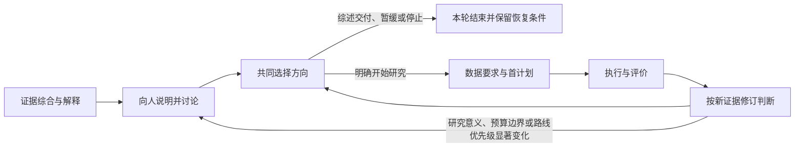

# 研究指导闭环：从证据综合到下一轮选择

准备向人解释综述时，先按[覆盖与收束](review-coverage-and-closure.md)说明本轮用途、已有依据和仍会影响方向的分支。重要缺口进入有界补查或讨论；人的实际选择继续保存在本指南的方向记录中。

在完成文献整理或一次研究后，研究者需要把证据讲给人听、共同选择方向，并把选择接到数据、计划、执行和后续解释。本指南把这些已有方法接成一条可分支、可返回的路径；综述可以独立交付，研究也可以在证据不足时暂缓或停止。

## 什么时候使用

当综述已形成可讨论的证据图景，需要选择下一步研究；当新结果可能改变研究目标、优先顺序、数据要求或资源预算；或当研究负责人需要把一轮结果接到新的决策时，使用本闭环。

仅需完成已授权的小型修复、格式对接或常规核查时，按现有任务上下文继续执行，并记录做了什么。若新发现影响结论含义、路线优先级、关键测量、诊断预算边界或预期用途，再把问题带回人讨论。

## 先把综合结果解释给人

以[研究前期准备](research-preparation.md)中的来源账本和证据图为基础，组织一份能帮助人作选择的说明。按当前主题取舍内容，重点讲清：

- 研究对象、实际测量和预期用途，以及哪些概念容易被混为一谈。
- 方法如何因先前限制、失败或新需求而演变；用关系图显示动机、能力和适用条件之间的联系。
- 主要共识及其条件、尚存分歧，以及最值得比较的一两种解释。证据支持的差异解释与待核实的工作假设分开呈现。
- 两到三个可行方向和一项有依据的推荐。只有一个现实方向时，说明其他路线受什么条件限制。
- 每个方向所需的数据与信息、成本和责任人、合理替代、失败和停止条件，以及什么证据会改变推荐。

把讨论集中到一两个真正需要人选择的问题。准备好的说明只表示已经可以讨论，实际意见、约束和选择要来自真实讨论并留有来源。

## 按研究需要推进各阶段

| 阶段 | 本轮工作 | 形成的记录 | 下一步 |
| --- | --- | --- | --- |
| 证据综合 | 连接来源、发现、方法、争论、候选问题和证据范围 | 面向人的综合说明 | 独立交付综述，或准备讨论下一方向 |
| 人与研究者讨论 | 将研究对象、证据、选择与代价解释清楚，收集真实意见和约束 | 可回到来源的讨论记录 | 进入方向选择；需要回复时保持等待 |
| 方向选择 | 选择继续阅读、开始研究、保持现状、暂缓或停止，并说明理由 | 有实际来源支持的方向决定 | 开始新研究，或结束本轮并记录恢复条件 |
| 数据与首计划 | 只对已选研究确定数据资格、用途、单位、预算和首计划 | D53 study bridge、D51任务上下文及封存首计划 | 进行首次审计或其他首个真实动作 |
| 执行与评价 | 让实际运行产物进入预定评价，记录结果和限制 | 任务绑定的运行、消费和评价记录 | 更新证据解释和下一步选择 |
| 证据修订 | 将新观察与原判据、主张和未知对照，决定保留、修改、收窄或停止 | 带证据定位的判断版本与下一动作 | 回到方向选择或封存本轮 |

有些工作会在证据综合后以综述结束；已获授权且不改变研究方向的常规任务可以沿现有任务上下文继续。需要人决定路线或重要约束时，进入真实讨论节点；方向选择由实际讨论记录支持。

## 把人的意见变成共同决定

讨论前，研究者给出基于证据的选项和推荐；讨论时，人补充研究目的、应用场景、可接受成本、已有知识、时间限制或其他未被证据账本覆盖的约束。把最后选择和理由连回相关发现、候选问题与方法。

方向决定可能是“先完成综述并独立交付”“围绕关键争论继续查证”“建立新研究版本”“保留现状”“暂缓等待某类证据”或“停止当前分支”。选择应符合实际授权。已有明确授权可以支持小范围延续；需要新的方向优先级或用途改变时，按真实讨论记录决定。

在新颖性或覆盖范围上，说明实际检索过哪些来源、截止时间和本次覆盖。将“本次范围内已见或未见”写清楚，并给出遗漏风险与后续查证价值。

## 选择研究后再接数据与计划

决定开始一项新研究后，用 D53 的准备记录把选中的问题、发现和方法接到数据要求。说明来源与版本、许可和可用性、实体和测量语义、要求字段、覆盖与分母、信息用途、责任人、预算、停止条件和验收依据。资源资格或实体关系仍有缺口时，调用[D52证据缺口闭环](resource-gap-loop.md)，可补充、换源、收窄、暂缓或停止。

研究问题和信息流确定后，Harness 原生路径按[D51任务连续性](task-continuity.md)固定 `study_id`、`iteration_id`、当前入口、工作根和下一未完成门；已有平台若能提供等效任务、决策和执行证据，可沿其原生记录或适配接口续接。首计划另存独立版本；会影响样本纳入、清洗或划分的审计先封存方案。Harness 原生封存方法见[计划封存与首次执行](plan-seal-and-first-execution.md)。划分、选择或估计单位不清时，参考[统计单位指南](statistical-units-and-selection.md)。跨程序交接数据时，依[真实工件接口](artifact-producer-consumer.md)打通一个实际生产—读取—下游事件。

历史综述可以作为新研究的背景输入。默认研究目标为当前问题，并说明综述的来源与覆盖时间；用历史窗口进入当前问题时，附可读的更新记录。更新可以是实际补查，也可以是有理由的评议，说明原有证据仍适用于当前目的，不设新增文献数量要求。若研究要重建相同历史窗口，记录该窗口的截止时间和沿用理由即可，窗口外材料不作为必要条件。以前的首计划、保护评价集和结果保持其原版本。见到结果后需要改变范围、纳入、清洗、划分或选择条件时，建立新版本并说明变化及受影响的判断。

各类记录分别维护版本：研究周期、来源账本、证据图、讨论记录和首计划各自引用自己的版本与路径，不要求版本号相同。阶段向前推进而研究范围与 D51 任务绑定不变时，沿用原讨论记录和首计划的版本及路径。

## 执行、评价与修订

恢复或交接时，先沿用当前任务入口重建本轮阶段和下一验收点。运行报告要关联当前任务和实际工作位置；评价记录引用实际消费的材料、指标、单位、分母和预定判据。执行记录说明产物和计算属于哪一轮；研究者再判断它们能支持哪些主张、不能支持哪些主张。

结果可以支持保留原方向、改变方法、收窄主张、补资源、暂缓或结束。每项判断引用观察到的发现或证据位置，并说明下一动作。在研究范围和 D51 任务绑定不变时，解释与修订阶段可以继续引用同一份真实运行，不因周期或阶段记录版本变化而重跑。改变研究范围、目标或 `iteration_id` 时，按 D51 建立并核查新的当前任务绑定；旧运行可作历史证据，不能充当与新任务绑定不符的当前运行。改变问题、预算或方案时新建周期版本并指回前一版本；收窄、暂缓、停止和维持原方向都可以结束当前周期或留下续接动作。旧方案、原始结果和此前讨论继续可追溯。需要解释生物学含义时，结合[生物学解释与交接指南](biological-explanation-and-handoff.md)，把测量对象、直接观察、代理量和模型预测分开讲。

## 记录与检查

可复制的研究周期和机器讨论记录见[示例目录](../../../examples/research-support/research-cycle/README.md)，人读讨论提纲见[讨论模板](../../../examples/research-support/research-cycle/HUMAN-DISCUSSION.template.md)。研究周期检查器核对记录、身份、引用路径和阶段接缝是否齐备；科学判断按相应研究评价。字段与条件见[机器设计](../../../machine/design/research-guidance-cycle.json)，设计理由见[D54研究指导闭环](../../design/31-research-guidance-cycle.md)。
