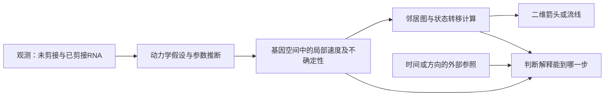

# 动态过程解释：从快照到方向，再到使用范围

版本：`research-facets-v0.2`，2026-10-20。以veloVI为条件工作例；[公开研究设计与方法索引](../../../../docs/REFERENCES-AND-DESIGN.md)支撑本次细化。首稿使用原有冻结指导，未使用本工作例；本工作例自身的应用效果另验。不将本例推广为所有时间序列研究的统一流程。

## 何时启用

研究从静态或稀疏观测推断变化方向、潜在时间、未来状态或轨迹，并准备据此解释生物过程时启用。先确定目标是**描述现有状态、判断局部变化方向、排列过程，还是预测未来**。每前进一步，需要的证据不同；没有动态主张时不制造动态验证任务。

[veloVI论文](https://doi.org/10.1038/s41592-023-01994-w)用单细胞中未剪接与已剪接RNA的丰度推断速度，并分析不确定性和适用性。两种RNA丰度是快照观测；时间、状态和动力学参数参与模型推断。论文同时使用模拟、细胞周期的正交参照、预处理稳健性和置换诊断，不能将它概括为仅凭流线图说明动态。

## 先向人解释“箭头”来自哪里

可以把未剪接与已剪接RNA看成相互联系的两个池。当前两池的数量，结合转录、剪接和降解的假设，可帮助估计成熟RNA接下来可能增加还是减少。我们观察到的是两池丰度，局部方向是据这些假设推断出来的；二维图上的箭头又经过邻居图与投影。

拟合得好、方向相邻一致、二维图平滑和真实动态正确，是不同读出。画面可以解释已核查的结果，也可能让错误方向看起来连贯。

## 第一步：锁定观测、尺度和假设

记录细胞/基因ID、两种丰度的计数与预处理来源、过滤、平滑和所用细胞集合。解释变化的是哪个RNA量、在哪个空间和尺度中计算，不把归一化后的模型速度自动解释为每小时的物理速率。

veloVI基本模型包含诱导、相应稳态、抑制和相应稳态等状态假设；为参数辨认还施加共同时间尺度约束。基因特异潜在时间是模型推断量，真实采样时刻应由采样记录提供。推广到其他过程前，检查观测是否覆盖所需状态，以及数据是否包含其他动力学机制或分支。

若准备解释速率幅度或跨基因快慢，要继续问数据约束了哪些参数、哪些尺度靠人为固定。对全体速度乘同一正数，方向可以保持而幅度改变；这与逐基因变换又不同。明确相对方向的合法用途，可以完成这条路线；基本速率参数的辨认、扩展模型的参数辨认和完整后验不确定性不能互相代答。最大时间20等设定按作者模型解释，不把它当作真实小时或每例都必须使用的常数。

来源：正文Methods“Model assumptions”“Variational posterior”“Downstream tasks”；模型扩展另见“Time-dependent transcription rate”。这里区分的是观测与推断，不要求每个研究先证明全部动力学参数唯一可辨。

## 第二步：按当前问题选验证

| 要判断什么 | 一条可实施的路线及理由 | 合法替代或限域 |
|---|---|---|
| 模型是否描述当前观测 | 核相图、拟合误差、覆盖与预处理变化，定位失败细胞/基因 | 仅报告描述性拟合；不扩写成方向正确 |
| 局部方向是否有支持 | 用与待检结论相匹配、来源清楚的时间/方向参照，评价基因空间的方向或符号 | 可用适合假设的模拟检查算法；若无外部参照，只保留模型内一致性及其范围 |
| 这份数据是否适合当前速度解释 | 比较暂态连接证据与合适的负/部分正参照，结合模型与数据诊断 | 无法区分稳态群体或暂态缺失时，先限域到有支持的群体/基因，或停用方向解释 |
| 不确定性是否改变使用范围 | 分别解释模型内部速度方向的波动与邻居/转移计算带来的波动，回到决定所需的读出 | 只展示无法据此验收；也可选择保守的描述性解释 |
| 未来状态或过程是否能预测 | 采用与该目标对应的后续观测、时间/谱系等外部证据和适用比较 | 当前快照与转移图只支持条件性推断时，保留该范围，不声称已观测到真实后继关系 |

FUCCI蛋白读出在论文中作为细胞周期的正交参照及方向/时间启发式；它不是所有细胞过程的精确时钟。模拟检验的是设定生成机制下的表现；一种生成机制上的成功，不代替新生物体系的验证。

选择一个小型方向验证时，可以先复用RPE1-FUCCI的保存输出：RNA用于模型拟合，蛋白来源的周期顺序用于评价，固定基因、区间和周期边界处理，再比较相同对象上两方法的方向符号。论文参照仍由沿该顺序的RNA中位数差分构造，因此补看未平滑RNA的敏感性有助于识别共享预处理的影响。所选用途是当前队列内的方向解释时，不必强加新供体训练；只有主张跨供体泛化时才增加对应留出。论文中“66%/68%的基因优于比较方法”也不能改写成“方向准确率66%/68%”。

细胞、基因、后验样本与独立生物重复回答不同问题。增加同一细胞的后验抽样只改进相应条件分布的估计，不能增加独立供体数；同一预处理得到的基因/区间也未必彼此独立。当前队列可以先交逐对象描述，只有进行更广泛推断时，才按实际采样设计确定重采样单位和统计比较。

## 第三步：把适用性诊断写具体

veloVI提供一个值得借鉴的条件诊断：在每个细胞类型、每个基因内，分别置换两种RNA丰度对应的细胞条码；将置换矩阵送入已训练模型，比较原始与置换输入的拟合误差。作者再按细胞类型汇总到基因分数，并与参照数据的分布比较。这里不需要对每次置换重新训练模型。

它检验观测中是否包含该模型可利用的暂态关联。置换敏感性支持“模型能利用这类关联”的判断，轨迹真实性仍需与相应外部参照核对；低敏感性则提示暂态采样、噪声或模型适配可能限制解释范围。

作者还给出一个实际限制：过粗的细胞群标签混合不同丰度状态，可能影响置换分数的解释。因此先检查分组、相图和数据构成，再决定该诊断是否适用。本例不强制其它动态模型沿用这项置换、作者的样本上限或某个固定分数阈值。

例如用PBMC检查误用风险时，先保留逐群、逐基因误差及相图，再看取最大值后的摘要；群体数改变也会改变“最大”读出。只有粗标签或多峰构成确实妨碍解释，才触发有独立依据的细分。细分后分数降低，同时也可能来自细胞数或变化范围减少，不能单凭下降认定原来只有混合效应。保留u/s配对的共同条码置换和分别置换破坏不同关联，可作为条件对照；二者本身都不是动态真假的直接观测。不要反复修改分群直到得到预期图形。

来源：Results“veloVI identifies insufficiently observed or steady-state dynamics”，Methods“Permutation scoring”，以及补充中的PBMC和dentate gyrus应用。若模型、分组方式或观测模型不同，需重新说明置换保留了什么、破坏了什么，才能采用。

## 第四步：让不确定性与可视化服务决定

**先检查统计量能否区分当前关心的状态。** 早稿补充第6页式(28)以及发表版Methods，将各速度样本与均值的余弦相似度再取方差。一个向东、一个向北的两个向量，与东北均值的夹角相同，所得方差为零，但两方向并不集中。这是定义的解析反例，不是对真实数据出现频率或实际实现的结论。若要把低值解释为方向可靠，先核公式/实现，再用保存样本检查这种退化是否影响当前使用；也可采用有理由的方向集中读出，或明确限于该统计量的描述性用途。不要求每项研究都构造同一种反例。

[公开研究设计与方法索引](../../../../docs/REFERENCES-AND-DESIGN.md)

图为解析示意：两方向相差90°，各自与均值夹角45°；右侧两个相似度均为`1/√2`。它帮助解释统计量的性质，没有消费生物数据或运行模型。[公开研究设计与方法索引](../../../../docs/REFERENCES-AND-DESIGN.md)保留。

**把公式接到实际实现。** 本轮取得的官方`_model.py`快照在`_cosine_sim`中先按基因中心化向量，再归一化；`np.var`分母也与论文式中的`L−1`不同（来源`velovi:code-model`，1086–1123行）。因此该二维解析例描述的是论文定义，快照采用的计算会得到不同读出；中心化后示例均值向量为零，方向无定义。新验证应先选定论文或代码定义，保存调用及返回字段，并说明零范数处理；需要时用另一种定义作敏感性分析。当前快照与论文历史运行的对应关系未知，这项源码观察用于界定方法，不评价论文当次计算。

**再说明随机对象。** 哪些参数取点估计、哪些状态先取期望、最后对什么采样？对“平均未来位置”的不确定性，与“未来可能位置”的全部分散是两件事：两个分散后继各占一半时，中间平均位置可以完全稳定。明确估计前者是合法路线；只有声称完整后继风险时，才需要相应传播。增大后验样本数不能修复统计对象或聚合定义不匹配。

- **内在不确定性（intrinsic）：** 论文根据后验速度样本相对平均方向的变化作量化。低波动可与模型共同偏差并存；解释时结合外部参照与数据诊断。
- **外在不确定性（extrinsic）：** 这里指经速度引导的邻居转移计算后，预测未来状态的变化；它不是新的独立生物观测。明确邻居图、基因空间和后验样本怎样被消费。
- **接近零的速度：** 平均方向或向量范数接近零时，方向相似度可能不稳定或无定义。保留这一状态，不把它随意填成“确定静止”。
- **二维呈现：** 向读者同时解释代表性相图、模型支持的范围与不确定性，再展示流线。邻居或投影改变方向时，先定位变化在哪一步，不仅凭漂亮图决定。

## 第五步：把诊断接到具体使用单位

| 决定单位 | 相应决定与所需解释 |
|---|---|
| 整份数据 | 是否继续当前速度解释；说明参考的适用性、暂态覆盖及停用范围 |
| 细胞群体 | 哪些群体可解释、哪些需限域；排除群体时保留身份、相图与选择依据，不将离群群体自动视为谱系过渡 |
| 个别基因 | 可探索支持/不支持动态解释的基因；若据同一目标流图反向筛基因，再把新图当验证，需明确这一选择反馈 |

公开回复分别说明了这些用途，并提醒按基因分数挑选用于细胞级汇总的基因可能形成得到预期结果的反馈；发表版讨论又将基因过滤作为进一步分析的例子。两种表述按用途保存，不推成统一禁令。预先说明的基因选择可以成立，探索性选择也可以保留；其产物不自动成为独立的方向证据。说明保留和排除对象，比只展示一个有利分布更有助于接手者使用。

补分析后再看原主张：真实数据参数生成的模拟仍可能沿用理想化生成机制，FUCCI的顺序与符号仍是启发式参照。公开后续评审要求补清这些边界、方法细节和逐方法读出，作者以新增结果和文字限域共同回应。新增图表并不独自决定接受范围。

## 什么结果会改变解释

| 观察 | 下一决定 |
|---|---|
| 拟合好、流线平滑，但外部方向参照不相容 | 收窄方向/未来解释，保留可支持的描述性拟合；检查观测、模型与图的接缝 |
| 对照、暂态覆盖和方向证据在当前范围相互支持 | 接受该范围的局部动态解释，不自动扩展到其它群体或物理时间尺度 |
| 不确定性集中于特定状态，或转移随合法邻居/处理选择显著改变 | 限制这些状态的使用，说明需要的补充证据；不把全部数据一并判失效 |
| 诊断接近适用的负参照，或观察只有混合稳态而无可辨暂态 | 停用或缩小当前速度/轨迹解释；体系是否存在动态需由其他观测回答 |
| 外部参照、群体身份或状态覆盖缺失 | 交付明确缺项的条件性设计；不把模型自洽升级为独立真实性 |

## 最小交接及Harness入口

交接“观测→假设→推断量→邻居/投影→主张”的来源链，给出所选路线、必要输入、具体诊断读出、合法替代、改变结论的条件和一段人读解释。实际执行后，再附逐对象结果与参数/样本/图的消费证据。

联用[单细胞边界](../cards/single-cell-boundaries.md)、[信息与状态](../guides/information-and-state-effects.md)、[测量到主张](../guides/measurement-to-claim.md)、[可视化](../cards/visualization-efficiency.md)及[置信度到决定](confidence-to-decision.md)。完整引用、原件与实现版本见[公开研究设计与方法索引](../../../../docs/REFERENCES-AND-DESIGN.md)。
