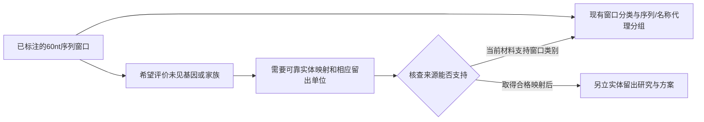

# Splice：怎样从已有结果讨论下一研究方向

本例回看已经完成的 Splice 资源准备，把对象、方法限制和下一步取舍组织成一份讨论简报。新的研究方向由下一次实际交流确定。

## 先说清研究对象

[UCI Splice 数据](https://doi.org/10.24432/C5M888)保存了3,190个长度为60个核苷酸的序列窗口，以及 EI、IE、N 三种档案标签。当前分类任务回答的是这些历史窗口的类别。基因、蛋白家族、序列窗口和名称前缀分别表示不同对象；划分时选哪一种，决定评价能回答什么泛化问题。

已核查的官方网页与归档说明提供类别、名称和序列，但没有可用于本轮研究的权威窗口—基因／家族对应关系。归档对 EI、IE 的供体／受体文字还存在内部冲突，因此当前保留档案标签，别名释义待核。

## 方法选择为什么走到这里

序列相似度可帮助识别相近窗口，名称前缀可以形成透明的字符串分组。跨基因或家族的结论需要把窗口接到相应生物实体，并处理一对多、映射未知及样本覆盖。已有[资源准备结果](../../../../examples/splice/README.md)为这项区别提供了实际依据。

## 现在可以比较什么

| 方向 | 希望回答什么 | 所需材料与主要成本 | 当前理由与替代 | 什么会改变选择 |
|---|---|---|---|---|
| 保留窗口分类，围绕既定数据补充诊断 | 现有模型在哪些窗口与条件下表现不同 | 复用已接受的数据、保存状态和原评价；新分析另定方案与CPU预算 | 现有对象和类别已足以支持这一范围；也可先以现有结果结束 | 新用途明确要求实体泛化，或已有结果暴露需要实体信息的解释缺口 |
| 为基因／家族留出评价获取新资源 | 模型在未见生物实体上的表现是否仍成立 | 许可和版本清楚的权威实体链接、坐标与链信息；先做有界可用性核查，再决定是否计算 | 直接回答新增目标；可换用身份关系更完整的数据，或暂缓此分支 | 新来源确实覆盖所需窗口，映射资格和未知处理足以支持目标评价 |

当前建议保留已接受的窗口分类范围，把实体泛化作为有条件的后续分支。若最看重的是跨实体用途，下一项任务应先核资源资格；若优先理解现有模型，则从一个能影响结论的窗口诊断开始。

## 需要共同决定的两点

1. 当前更希望理解既有模型的适用条件，还是优先回答跨生物实体的泛化问题？
2. 如果选择实体方向，愿意先给资源可用性核查多少时间；达到什么缺口边界后换数据或暂缓？

讨论后记录实际选择、理由、新约束和责任人。选定计算方向后，再将对应问题、方法、数据要求和验收条件接入新的研究桥接与首计划。

## 评价后怎样回到判断

- 若合格映射只覆盖部分窗口，先报告覆盖与排除，再判断共同样本能回答哪些问题。
- 若新分组改变表现，比较实体分离与样本变化各自的影响，再更新用途建议。
- 若仍缺可靠实体关系，保留窗口任务，留下恢复实体分支所需的资料。
- 若新分析改变问题、数据或选择条件，另存方案与结果版本，回到原判断说明改变原因。

本例来源为 G. Towell、M. Noordewier、J. Shavlik 的 UCI 数据及项目已完成的官方材料核查，详细归属见[Splice应用](../../../../examples/splice/README.md)，来源与方法关系见[公开索引](../../../../docs/REFERENCES-AND-DESIGN.md)。
